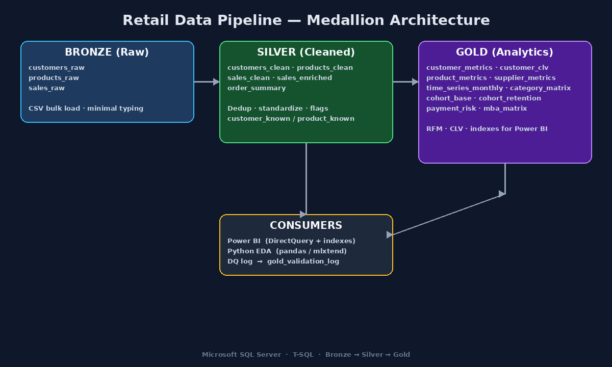

# Retail Data Pipeline — Medallion Architecture in T-SQL



End-to-end data cleaning, enrichment, and analytics-layer build for a
~4,700-row retail sales dataset. Implements a Bronze → Silver → Gold
architecture in Microsoft SQL Server, with severity-graded data quality
validation and Power BI-ready indexes.

## Highlights

- **4,711** cleaned sales rows retained after filtering invalid quantities, placeholder prices, and out-of-range discounts
- Documented data-quality anomalies **retained and flagged**, not silently dropped (unknown customers, unknown products, missing payment methods)
- **16** reusable SQL modules + 1 executable SQL notebook
- **10** Gold-layer analytics tables (RFM, CLV, cohort retention, supplier scorecard, payment risk profile, market-basket pre-aggregation)
- **BLOCKING / WARNING** severity model — pipeline treats corruption as blocking and ambiguity as warning

## Architecture

```
Bronze (raw CSV)
    → Silver (cleaned + flagged)
        → Gold (metric tables)
            └→ Power BI / Python EDA
```

| Layer  | Tables |
| ------ | ------ |
| Bronze | `customers_raw`, `products_raw`, `sales_raw` |
| Silver | `customers_clean`, `products_clean`, `sales_clean`, `sales_enriched`, `order_summary` |
| Gold   | `customer_metrics`, `customer_clv`, `product_metrics`, `supplier_metrics`, `time_series_monthly`, `cohort_base`, `cohort_retention_rates`, `category_monthly_matrix`, `payment_risk_profile`, `mba_order_product_matrix` |

## Data Quality Issues Found & Resolved

| Issue | Treatment |
| ----- | --------- |
| Duplicate `customer_id` | Deduplicated via `ROW_NUMBER()` |
| Invalid signup dates (e.g. `2023-13-45`) | `TRY_CAST` → NULL |
| Inconsistent region / spelling | Canonical `CASE` mapping (Tehran, Mashhad, Isfahan, …) |
| Inconsistent loyalty tier casing | Canonical `CASE` mapping (Bronze / Silver / Gold / Platinum) |
| `base_price = 0` for one product | Set to NULL, then imputed with category median (`PERCENTILE_CONT`) |
| Missing `supplier_code` | Filled with `'Unknown'` |
| Duplicate sales rows | Deduplicated on `(order_id, product_id, order_date)` |
| Negative / zero quantities | Removed (BLOCKING) |
| Placeholder `unit_price` (&lt; 1000) | Removed (BLOCKING) |
| `discount_pct` outside [0, 100] | Removed (BLOCKING) |
| Missing `payment_method` (23 rows) | Retained as NULL / standardized later; tracked in docs |
| Missing / inconsistent `region` on sales | Filled from customer master, else `'Unknown'` |
| Unknown `customer_id` (no match in customers) | Retained, flagged `customer_known = 0` |
| Unknown `product_id` (no match in products) | Retained, flagged `product_known = 0` |

Full discussion: [`docs/data_quality_findings.md`](docs/data_quality_findings.md)

## Repository layout

```
retail-data-pipeline/
├── README.md
├── LICENSE
├── .gitignore
├── notebooks/
│   └── retail_cleaning_pipeline.ipynb   # narrative + executable end-to-end
├── sql/                                 # reusable modules (git-friendly diffs)
│   ├── 01_setup.sql
│   ├── 02_clean_customers.sql
│   ├── 03_clean_products.sql
│   ├── 04_clean_sales.sql
│   ├── 05_enrich.sql
│   ├── 06_compute_metrics.sql
│   ├── 07_validation.sql
│   ├── 08_silver_dq_extended.sql
│   ├── 09_analytics_customer_metrics.sql
│   ├── 10_analytics_product_metrics.sql
│   ├── 11_analytics_supplier_metrics.sql
│   ├── 12_analytics_time_series.sql
│   ├── 13_analytics_cohort.sql
│   ├── 14_analytics_payment_risk.sql
│   ├── 15_analytics_mba_matrix.sql
│   └── 16_indexes.sql
├── docs/
│   ├── architecture.md
│   └── data_quality_findings.md
├── data/
│   └── .gitkeep                         # raw CSVs are gitignored
└── images/
    └── architecture.png
```

Notebooks are the narrative artifact; `.sql` files are the reusable source. Reviewers can diff individual modules without parsing notebook JSON.

## Tech Stack

- Microsoft SQL Server 2019+
- T-SQL (window functions, CTEs, `PERCENTILE_CONT`, `NTILE`, `LAG`, `STRING_AGG`)
- VS Code SQL Notebooks (MSSQL extension)
- Planned: Python (pandas, mlxtend) for EDA + market-basket analysis

## How to Run

1. Create the database and schema:

```sql
CREATE DATABASE RetailDB;
GO
USE RetailDB;
GO
CREATE SCHEMA retail;
GO
```

2. Bulk-insert the three raw CSVs into `retail.customers_raw`, `retail.products_raw`, and `retail.sales_raw` (place files under `data/` locally; they are gitignored).

3. Either:
   - Open `notebooks/retail_cleaning_pipeline.ipynb` in VS Code and **Run All** top-to-bottom, **or**
   - Execute the scripts in `sql/` in numeric order (`01` → `16`).

4. Confirm Gold readiness:
   - `retail.customer_metrics` row count should equal distinct known customers in `sales_enriched` (one row per `customer_id`).
   - The Gold validation sweep should report PASS / INFO for non-blocking checks.

## Gold layer outputs (handoff)

| Table | Grain | Primary use |
| ----- | ----- | ----------- |
| `customer_metrics` | 1 row / customer | RFM scores, loyalty, region |
| `customer_clv` | 1 row / customer | Lifetime value estimates |
| `product_metrics` | 1 row / product | Revenue rank, return rate |
| `supplier_metrics` | 1 row / supplier | Supplier scorecard |
| `time_series_monthly` | 1 row / year-month | Revenue trend, MoM growth |
| `cohort_base` | order-level cohort keys | Raw cohort input |
| `cohort_retention_rates` | cohort × index | Retention heatmap |
| `category_monthly_matrix` | category × month | Category mix over time |
| `payment_risk_profile` | 1 row / payment method | Risk / return rates |
| `mba_order_product_matrix` | order × product | Apriori market-basket input |

## Roadmap

- [x] Bronze → Silver cleaning
- [x] Silver → Gold analytics layer
- [x] Severity-graded DQ validation
- [x] Power BI–oriented indexes on Gold tables
- [ ] Python EDA notebook (distributions, correlations)
- [ ] Market-basket analysis (`mlxtend` Apriori on `mba_order_product_matrix`)
- [ ] Power BI dashboard (DirectQuery against Gold)

## License

MIT — see [LICENSE](LICENSE).
